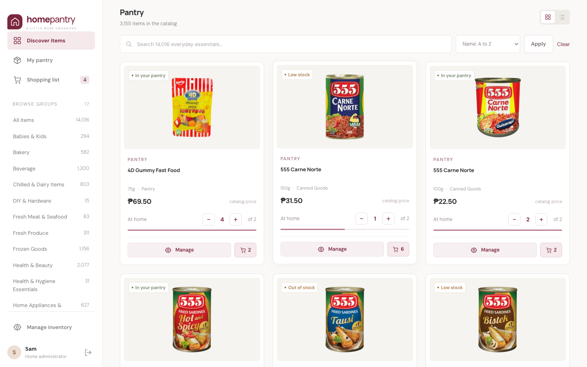
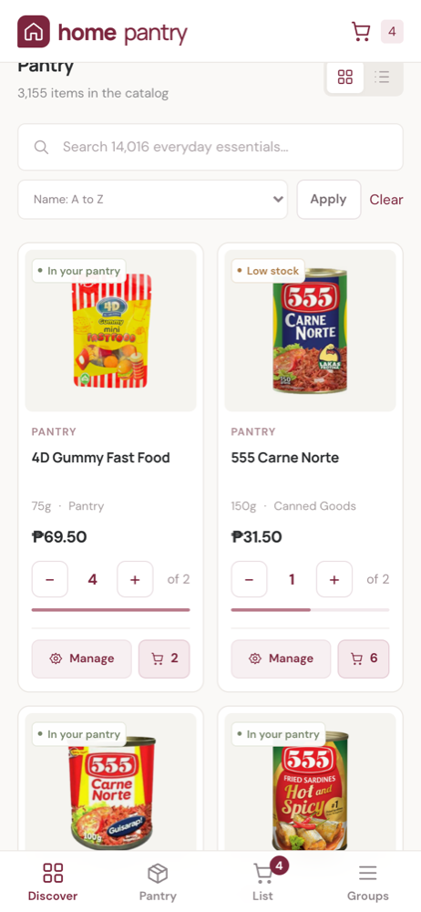
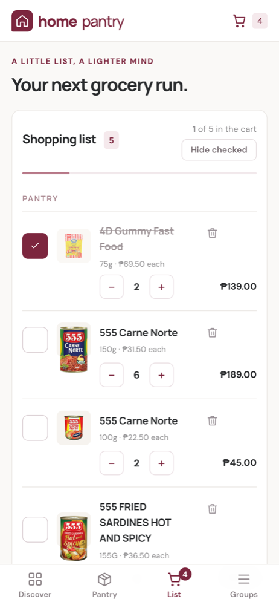

# Home Pantry

A small, self-hosted home inventory: browse a catalog of grocery and household
products, pick the ones you keep at home, track how many you have, and build a
shopping list you can tick off on your phone in the store.

Built with Laravel 13 and SQLite, with no JavaScript framework and no build step.



## Features

- **Catalog ("Discover items")**: 3-column product cards with photos, sizes
  and prices, grouped by catalog group in the sidebar. Search, sort, and switch
  between grid and list view.
- **My pantry**: your personal stock. Add products from the catalog, set
  how many you have and how many you want to keep, and adjust with − / + as you
  use things up. Filter by *needs a refill* or *out of stock*.
- **Restock low items**: one tap puts every below-target pantry item on the
  shopping list for the amount you're short.
- **Shopping list with checklist**: grouped by aisle (catalog group), with big
  tick boxes, quantity steppers and an estimated total. *Hide checked* keeps the
  list short in the store, and *Stock checked items* moves what you bought into
  your pantry.
- **Admin area**: create, edit and delete products, import a CSV, and watch
  photo downloads progress.
- **CSV importer**: upserts products by SKU and keeps pantry stock and
  shopping lists intact. Each product's `image` URL is downloaded in the
  background and stored locally (resized to 600px WebP by default), so the app
  never hotlinks the shop.
- **Mobile friendly**: bottom tab bar, swipeable group chips, and a list that
  updates in place without reloading. It can be added to the home screen.
- Maroon accent throughout.

<p>
  
  
</p>

## CSV format

```csv
sku,group,name,image,type,size,price
20413368,Babies & Kids,Sanicare Baby Wipes Cucumber,https://example.com/wipes.png,Babies & Kids,15sheets,36.75
```

| Column  | Meaning                                                             |
|---------|---------------------------------------------------------------------|
| `sku`   | Unique product code. Re-importing the same SKU updates the product. |
| `group` | Catalog group shown in the sidebar (e.g. *Pantry*, *Beverage*).     |
| `name`  | Product name.                                                       |
| `image` | Photo URL, downloaded and kept locally. May be empty.               |
| `type`  | Sub-type (e.g. *Canned Goods*).                                     |
| `size`  | Pack size (e.g. *500g*).                                            |
| `price` | Catalog price in ₱, used for the shopping-list estimate.            |

The bundled [`inventory.csv`](inventory.csv) (about 14,000 products) is imported
automatically into an empty catalog the first time the Docker container starts.
Import more from **Manage inventory → Import CSV**, or from the command line:

```bash
php artisan inventory:import path/to/inventory.csv
```

## Local development

With [DDEV](https://ddev.com):

```bash
ddev start
ddev composer install
ddev exec 'cp -n .env.example .env; php artisan key:generate'
ddev exec 'touch database/database.sqlite && php artisan migrate'
ddev artisan inventory:import inventory.csv
```

Open https://inventory.ddev.site. The first visit asks you to create the admin
account. DDEV also runs a queue worker (see `.ddev/config.yaml`) that downloads
product photos. To fetch only a few while developing:

```bash
ddev artisan inventory:import inventory.csv --no-images
ddev artisan inventory:images --category=Pantry --limit=100
```

Without DDEV (PHP 8.3+ with the `pdo_sqlite` and `gd` extensions):

```bash
composer setup          # install, .env, key, migrate, import the CSV
composer dev            # http://127.0.0.1:8100
php artisan queue:work  # in another terminal, downloads photos
```

Run the tests with `php artisan test`.

## Accounts

The first person to open a fresh install creates the administrator account.
Admins manage the shared catalog. Each account has its own pantry and shopping
list. Add more household accounts from the command line:

```bash
php artisan inventory:user someone@example.com          # regular account
php artisan inventory:user someone@example.com --admin  # can manage the catalog
```

## Deploying

Same setup as the other home apps: a multi-arch image is published to GitHub
Container Registry on every `vX.Y.Z` tag, and Portainer pulls it. See
[README-DOCKER.md](README-DOCKER.md).

## Roadmap

- Recipes: pick a recipe and have its ingredients added to the shopping list
  automatically.
